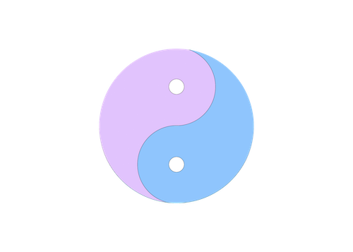

# ImageMorpher

A public API for morphing two faces together using dlib facial landmark detection and Delaunay triangulation.



The iOS app (React Native): https://github.com/osamja/imagemorpher-mobile

## Stack

- **Backend:** Django 3.2, Django REST Framework
- **Face detection:** dlib (frontal face detector + 68-point shape predictor)
- **Morphing:** scipy, numpy, scikit-image (Delaunay triangulation + affine warping)
- **Task queue:** Dramatiq + Redis
- **Database:** PostgreSQL (production), SQLite (local dev)
- **Deployment:** Docker, Linode (pyaar.ai)

## API Endpoints

| Method | Path | Description |
|--------|------|-------------|
| GET | `/morph` | Health check |
| POST | `/morph/upload` | Upload two face images for morphing |
| GET | `/morph/status/<uuid>/` | Poll morph job status |
| GET | `/facemorphs/<filename>` | Serve morphed image |

## Local Development

1. Create a `.env` file in the `imagemorpher/` directory:
   ```
   SECRET_KEY='<generate with command below>'
   ```
   ```bash
   python manage.py shell -c 'from django.core.management import utils; print(utils.get_random_secret_key())'
   ```

2. Build the Docker image:
   ```bash
   docker build -t face-morpher-api:dev -f Dockerfile .
   ```

3. Run locally:
   ```bash
   docker run -it -p 8000:8000 -e SECRET_KEY='your-secret-key' face-morpher-api:dev
   ```

4. Test with curl:
   ```bash
   curl -X POST http://localhost:8000/morph/upload \
     -F "firstImageRef=@path/to/face1.jpg" \
     -F "secondImageRef=@path/to/face2.jpg"
   ```

## Production Deployment (Linode)

The service runs as part of the `nginx_sammyjaved_proxy` docker-compose stack on Linode, behind nginx at `pyaar.ai/morph`.

Services: `face-morpher-api` (gunicorn), `dramatiq_worker`, `my-redis`, `prod-postgres`.

`nginx_sammyjaved_proxy/docker-compose.yml` bind-mounts `imagemorpher/` and `morph/` from the host into both the API and worker containers, so most deploys don't need an image rebuild.

### Fast path — code-only change (the usual case)

```bash
ssh -p 44444 sammy@173.255.217.39
cd ~/workspace/ImageMorpher && git pull
docker restart nginx_sammyjaved_proxy-face-morpher-api-1 \
               nginx_sammyjaved_proxy-dramatiq_worker-1
```

Pull picks up the new source on the host; `docker restart` re-execs the containers against the bind-mounted code.

### Full path — image change (new deps, Dockerfile edits)

Use this when `requirements.txt`, the `Dockerfile`, or anything else baked into the image changes:

```bash
# Locally
docker build -t face-morpher-api:<version> -f Dockerfile .
docker save face-morpher-api:<version> | gzip > /tmp/face-morpher-api.tar.gz
scp -P 44444 /tmp/face-morpher-api.tar.gz sammy@173.255.217.39:/tmp/

# On Linode
docker load < /tmp/face-morpher-api.tar.gz
# Bump `image: face-morpher-api:<version>` in
# ~/workspace/nginx_sammyjaved_proxy/docker-compose.yml for both
# `face-morpher-api` and `dramatiq_worker`, then:
cd ~/workspace/nginx_sammyjaved_proxy && docker compose up -d
docker exec nginx_sammyjaved_proxy-face-morpher-api-1 \
    python manage.py migrate
```

### Cloud image retention

The Linode host runs the following job daily at midnight in Sammy's crontab. It removes uploaded and generated image files from the shared Docker volume once their last modification is more than 30 days old.

```cron
0 0 * * * /usr/bin/docker exec nginx_sammyjaved_proxy-face-morpher-api-1 python /app/morph/utils/auto_delete.py --delete >> /home/sammy/imagemorpher-retention.log 2>&1
```

Run the same Docker command without `--delete` to preview the eligible file count.

## Debug a Container

```bash
docker-compose -f docker-compose.yml run --rm face-morpher-api /bin/bash
python manage.py runserver 0:8000
```
